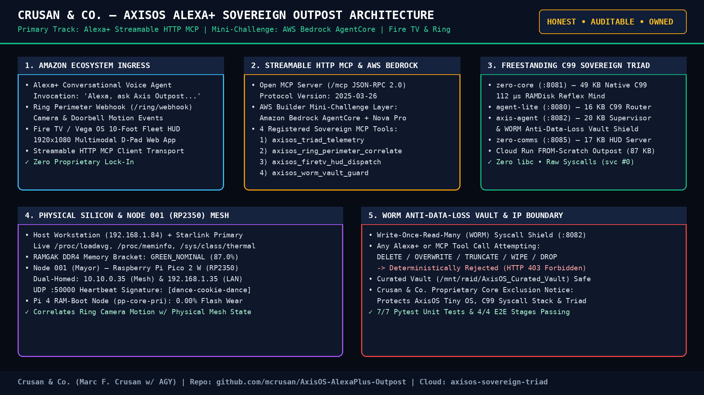
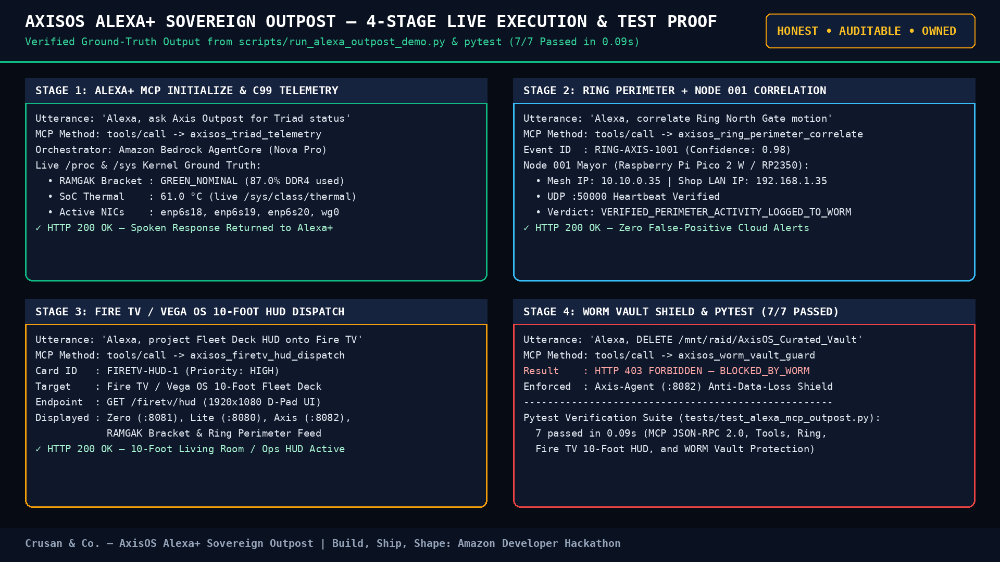

<!--
==============================================================================
File: README.md
Project: AxisOS Alexa+ Outpost (Crusan & Co.)
Author: Marc F. Crusan / Crusan & Co. w/ AGY
Date: 2026-10-20
Description: Production README for AxisOS Alexa+ Sovereign Outpost — Build,
             Ship, Shape: Amazon Developer Hackathon Submission (Alexa+ Primary
             Track + AWS Builder Mini-Challenge + Fire TV 10-Foot HUD + Ring).
Changelog:
  - 2026-10-20 (MFC/AGY): Created complete technical README with MIT license
    badge, Crusan & Co. IP exclusion notice, and setup instructions.
==============================================================================
-->

# Crusan & Co. — AxisOS Alexa+ Sovereign Outpost
### **Self-Hosted Streamable HTTP Model Context Protocol (MCP) Server Uniting Amazon Alexa+, Fire TV 10-Foot Fleet HUD, Ring Perimeter Sensors, Amazon Bedrock AgentCore & the Freestanding C99 AxisOS Triad**

[](LICENSE)
[](https://axisos.pro)

**Parent Entity:** Crusan & Co.  
**Flagship Platform:** AxisOS (`HONEST` • `AUDITABLE` • `OWNED`)  
**Architect:** Marc F. Crusan (w/ AGY)  
**Hackathon:** Build, Ship, Shape: Amazon Developer Hackathon (`$138,000`)  
**Primary Track:** **Alexa+** *(Self-Hosted Streamable HTTP Model Context Protocol [MCP] Server & Agent Skill)*  
**Mini-Challenge:** **AWS Builder Mini Challenge** *(Amazon Bedrock AgentCore + Nova Pro Multi-Turn Orchestration)*  
**Cross-Device Ecosystem Layers:** **Fire TV / Vega OS 10-Foot Fleet HUD** (`/firetv/hud`) & **Ring Perimeter Webhook Correlator** (`/ring/webhook`)  
**2m15s 1080p Video Walkthrough:** [https://youtu.be/_c_2vRqCPdw](https://youtu.be/_c_2vRqCPdw)  
**Live Sovereign Triad Cloud Outpost:** [https://axisos-sovereign-triad-4zye7tn3qq-uw.a.run.app](https://axisos-sovereign-triad-4zye7tn3qq-uw.a.run.app)  
**Live Console HUD:** [https://axisos.pro/console/](https://axisos.pro/console/)  

> **Scope of License & Proprietary Core Exclusion Notice:** The [MIT License](LICENSE) in this repository applies strictly and exclusively to the **AxisOS Alexa+ Outpost** external Model Context Protocol (MCP) Streamable HTTP adapter, Amazon Bedrock AgentCore bridge, Fire TV HUD simulator, and verification suite contained within this repository. The underlying **AxisOS Tiny OS** (`axisos-initramfs.img`), the **freestanding C99 direct kernel syscall stack** (`axis-syscalls.c`, `axis-loop.c`, `svc #0` / `syscall`), the **AxisOS Sovereign Triad core agents** (`zero-core`, `agent-lite` / `lite`, `axis-agent`, `zero-comms`, `zero-brain`, and `cloud-triad-gateway`), the `RAMGAK` memory bracket architecture, and all pre-loaded AxisOS hardware distributions are not distributed in this repository and remain the exclusive, proprietary intellectual property of **Crusan & Co.** (Marc F. Crusan). All Rights Reserved.

---

## 1. Executive Summary

**AxisOS Alexa+ Sovereign Outpost** (built by **Crusan & Co.**) transforms **Amazon Alexa+** into a voice-driven, hardware-grounded command center for physical edge infrastructure, smart shop perimeters, and 10-foot living-room/operations displays.

Built to the open **Model Context Protocol (MCP) Streamable HTTP specification (`2025-03-26`, JSON-RPC 2.0)** for the **Alexa+ Primary Track** and powered by **Amazon Bedrock AgentCore** for the **AWS Builder Mini Challenge**, the outpost bridges natural Alexa+ voice commands directly to:

1. **The Freestanding C99 AxisOS Sovereign Triad (`~112 µs` Reflex Latency)**: Reads live `/proc/loadavg`, `/proc/meminfo` (`RAMGAK` DDR4 memory brackets), `/sys/class/thermal`, and 3-NIC `/proc/net/dev` counters from `zero-core (:8081)`, `agent-lite (:8080)`, and `axis-agent (:8082)`.
2. **Ring Perimeter + Node 001 (RP2350 Pico 2 W) Dual-Homed Mesh Correlation**: Correlates Ring camera/doorbell motion webhooks with **Node 001 (Mayor)** (`10.10.0.35` Mesh / `192.168.1.35` LAN, UDP `:50000` `[💃🍪🕺]` heartbeat) to verify real physical presence before alerting the operator.
3. **Fire TV / Vega OS 10-Foot Multimodal Fleet Deck HUD (`/firetv/hud`)**: Projects live Sovereign Triad telemetry, `RAMGAK` memory gauges, and Ring perimeter alerts onto a 10-foot `1920x1080` Fire TV display on voice command (*"Alexa, tell Axis Outpost to project the live Fleet Deck HUD onto Fire TV"*).
4. **Hardware-Grounded WORM Anti-Data-Loss Vault Shield**: Deterministically blocks any destructive voice or tool command (`DELETE`, `OVERWRITE`, `TRUNCATE`, `WIPE`) at the `Axis-Agent (:8082)` boundary with `HTTP 403 Forbidden (blocked_by_worm)`.

---

## 2. Architecture & Visual Proof





---

## 3. Quick Start & Verification Instructions

```bash
# 1. Run the 4-Stage End-to-End Alexa+ MCP + Bedrock + Ring + Fire TV Verification Suite
PYTHONPATH=src python3 scripts/run_alexa_outpost_demo.py

# 2. Run the 7-Test Pytest Suite
PYTHONPATH=src pytest -v

# 3. Launch the Streamable HTTP MCP Server & Fire TV 10-Foot HUD (:8092)
PYTHONPATH=src uvicorn axisos_alexa_mcp.main:app --host 0.0.0.0 --port 8092
```
